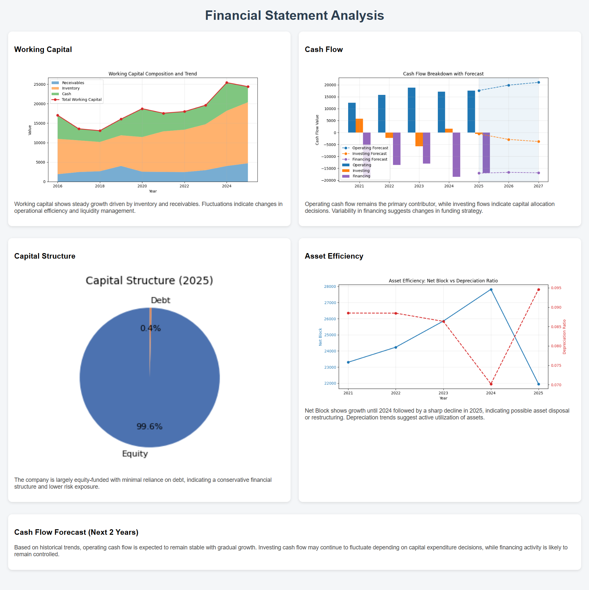

# Financial Health Analysis using Python

This project analyzes financial statements to evaluate a company’s financial health using Python.

## Overview
The analysis focuses on key financial components including working capital, cash flow behavior, capital structure, and asset efficiency.

## Key Features
- Working Capital Analysis (Receivables, Inventory, Cash)
- Cash Flow Breakdown (Operating, Investing, Financing)
- Capital Structure Evaluation (Equity vs Debt)
- Asset Efficiency Analysis (Net Block vs Depreciation)
- Forecasting using Holt’s Exponential Smoothing
- Automated HTML dashboard generation

## Tech Stack
- Python (Pandas, Matplotlib)
- Time Series Forecasting (Exponential Smoothing)
- HTML & CSS for reporting

## Output
The project generates a structured dashboard with:
- Financial trends
- Key insights
- Cash flow forecasts

## Dashboard
[View Dashboard](https://matrix36912.github.io/Financial-Health-Analysis/)
