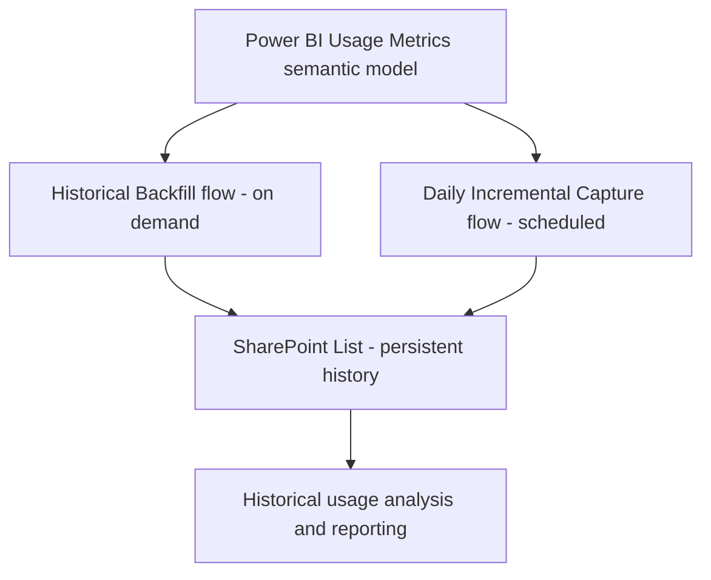

# Power BI Usage Metrics Archiver

A Power Automate pattern for preserving Power BI report usage history beyond the rolling window available in the Usage Metrics semantic model.

## Problem

Power BI Usage Metrics is rolling-window data, so it is not a reliable long-term historical store when stakeholders later ask for usage over a multi-month period. This project uses a SharePoint List as a persistent store, populated by two Power Automate cloud flows.

## Architecture

1. **Historical Backfill flow (manual/on demand):** Retrieves usage metrics for a chosen historical date range and writes the results to the SharePoint List. Use it to initialize the store or backfill a gap when data is still available.
2. **Daily Incremental Capture flow (scheduled):** Runs daily and writes new usage data to the same SharePoint List.
3. **SharePoint List:** Stores the accumulated usage records for later analysis, including multi-month reporting.

## Repository structure

- `flows/historical-backfill/`: document the date-range backfill flow.
- `flows/daily-incremental-capture/`: document the scheduled incremental flow.
- `sharepoint/list-schema.md`: record the SharePoint columns and deduplication key.
- `docs/setup-guide.md`: prerequisites, configuration, and setup.
- `docs/limitations.md`: rolling window and backfill limitations.

## Prerequisites

- Access to the Power BI Usage Metrics semantic model and permission to query it.
- Power Automate rights to create/run the flows and use the required connectors.
- A SharePoint site and list with the columns expected by the flow.
- Appropriate organizational approval for sharing or deploying the flow definitions.

## Suggested setup sequence

1. Create or identify the SharePoint List and document its schema.
2. Configure and test the Historical Backfill flow for a small date range.
3. Validate the captured rows and prevent duplicates using a stable record key where possible.
4. Configure the Daily Incremental Capture flow and its recurrence.
5. Check run history and row counts after each run.
6. Backfill missed dates only when the underlying Usage Metrics model still exposes the required data.
7. Validate multi-month reporting against the persisted SharePoint records.

## Important considerations

- A backfill cannot recover records that have already disappeared from the source's rolling window.
- Define a stable key and an upsert/deduplication strategy to avoid duplicate records when retries or backfills overlap.
- Confirm date/time zone handling, report/page identifiers, and the grain of each usage record.
- Refresh or query limits, model permissions, and connector throttling can affect capture completeness.
- A successful flow run is not by itself proof that every source row was persisted; validate row counts and failures.
- Review exported flow packages and solution files before publishing. Remove environment-specific values, connection details, tenant/site identifiers, sensitive data, and credentials.

## Flow documentation checklist

For each flow, add:
- Trigger type and schedule/manual parameters.
- Source query or dataset reference (use placeholders for internal names).
- Date-range logic and time-zone assumptions.
- SharePoint target columns and record key.
- Duplicate handling and retry behavior.
- Error handling and run-history validation.
- Screenshots only after removing company data and identifiers.

## Security and publishing

This repository should contain documentation and sanitized examples. Do not publish real usage records, access tokens, passwords, tenant secrets, private SharePoint URLs, or unreviewed exports. If the implementation belongs to an employer, check organizational policy before using a public repository. Prefer a private repository or sanitized source-control representation until approved.

## License

Choose a license only after confirming you have the rights to publish the implementation and documentation. If this is employer-owned work, follow your organization's policy.
